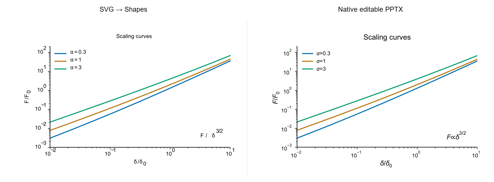
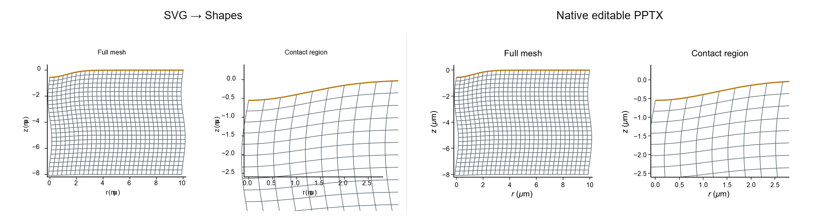
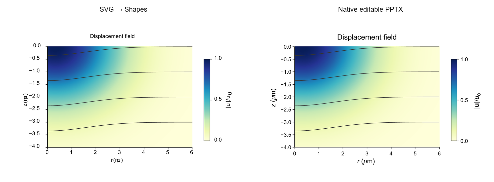
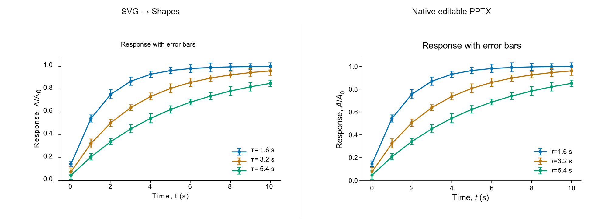

# Editable Scientific PPT

**在 PowerPoint 中直接修改科研图的文字、字号、曲线颜色和网格线宽。**

将绘图代码、数据或矢量图重建为原生可编辑 PPTX。文字保留为文本框，曲线和网格保留为形状，越界线条在导出前完成裁切。打开后即可编辑，无需再执行“转为形状”。

[效果对比](#效果对比) · [安装](#安装) · [使用](#使用) · [示例与复现](examples/gallery/README.md) · [MIT 许可证](LICENSE)

## 效果对比

以下四组均来自实际 PowerPoint 渲染。**左侧：Matplotlib SVG 插入 PPT 后“转为形状”；右侧：采用本 skill 的原生 PPTX。** 两侧使用同一份合成数据和源图。

测试环境：Windows PowerPoint，Office Build **16.0.20527.20196**。不同版本、字体和 SVG 导出方式的表现可能不同。

### 1. 双对数曲线与数学标注

处理希腊字母、上下标和旋转轴标签；将源 SVG 中的符号字体编码还原为可编辑 Unicode 文字。



[下载可编辑 PPTX](examples/gallery/results/01_math/native.pptx) · [普通转换 PPTX](examples/gallery/results/01_math/svg-converted.pptx) · [原始绘图](examples/gallery/results/01_math/source.png)

### 2. 网格与局部放大

普通转换后的局部网格越过坐标轴边界。原生版本先裁切几何，再生成可编辑的网格层。



[下载可编辑 PPTX](examples/gallery/results/02_mesh/native.pptx) · [普通转换 PPTX](examples/gallery/results/02_mesh/svg-converted.pptx) · [原始绘图](examples/gallery/results/02_mesh/source.png)

### 3. 云图、色标与单位

保留连续色彩图像，独立编辑坐标、色标文字和叠加线条。云图与色条本身仍是位图。



[下载可编辑 PPTX](examples/gallery/results/03_field/native.pptx) · [普通转换 PPTX](examples/gallery/results/03_field/svg-converted.pptx) · [原始绘图](examples/gallery/results/03_field/source.png)

### 4. 误差棒、多曲线与图例

普通转换在本例中基本保留了曲线和误差棒，但改变了混合文本的间距。原生版本将轴标题和图例保留为完整文本框，便于统一修改。



[下载可编辑 PPTX](examples/gallery/results/04_errorbars/native.pptx) · [普通转换 PPTX](examples/gallery/results/04_errorbars/svg-converted.pptx) · [原始绘图](examples/gallery/results/04_errorbars/source.png)

四个原生示例均已测试：修改标题字号、修改线宽、保存并重新打开。完整记录及修改后的文件见[实测说明](examples/gallery/README.md)。

## 安装

在 Codex 中使用 `$skill-installer`：

> 安装 https://github.com/Tanwu2000/editable-scientific-ppt 中的 skill，路径为仓库根目录。

也可直接克隆到个人技能目录（需要 Git）：

```sh
git clone https://github.com/Tanwu2000/editable-scientific-ppt.git ~/.codex/skills/editable-scientific-ppt
```

若使用自定义 `CODEX_HOME`，将目标改为该目录下的 `skills/editable-scientific-ppt`。安装后重新打开会话；如仍未显示，重启 Codex。

## 使用

提供绘图代码和数据，或保留文字的 SVG，然后输入：

> 使用 $editable-scientific-ppt，把这张科研图做成原生可编辑 PPTX。保留布局，文字使用 Arial，可修改字号；曲线和网格可修改线宽、颜色；裁切越界线条。同时输出 PNG 和 600 dpi TIFF。

优先提供源代码和数据。只有截图时，无法准确恢复被遮挡文字或原始数据。

| 图中内容 | 编辑方式 |
|---|---|
| 标题、坐标、刻度、图例、简单数学标注 | 原生文本框，可修改字体、字号和文字 |
| 曲线、误差棒、标记、边界 | 原生形状，可修改线条与颜色 |
| 密集网格 | 分层或分批的自由曲线，可修改整层线条 |
| 连续云图、显微图像 | 保留为图像，周围文字独立编辑 |

曲线是可编辑形状，不是关联 Excel 数据表的原生图表。复杂公式、非矩形蒙版和带孔填充可能需要专门重建；本工具不承诺任意 SVG/PDF 一键无损转换。

## 更新

GitHub 更新**不会自动覆盖已安装的副本**，也不会修改已生成的 PPTX。

Git 克隆安装可在检查本地改动后更新：

```sh
git -C ~/.codex/skills/editable-scientific-ppt pull --ff-only
```

复制安装可从下载的新版本目录执行：

```sh
python tools/install_local.py --dest ~/.codex/skills --update
```

复制更新会先备份旧版本，失败时回滚。需要固定版本时，可使用仓库的版本标签。

## 开发接口

核心场景导出器仅依赖 Python 标准库：

```sh
python scripts/native_pptx.py examples/minimal_scene.json build/example.pptx
python scripts/inspect_pptx.py build/example.pptx
python -m unittest discover -s tests -v
```

[场景格式](references/scene-format.md) · [文字与几何处理](references/geometry-and-text.md) · [PowerPoint 验证](references/powerpoint-qa.md)
