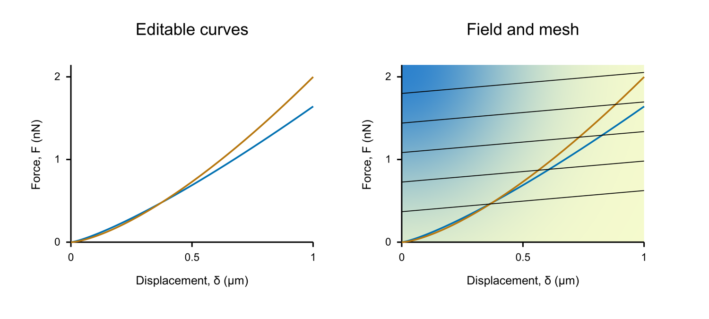
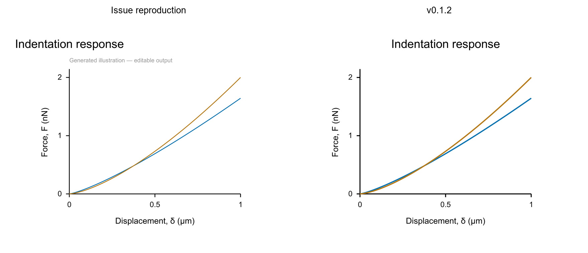
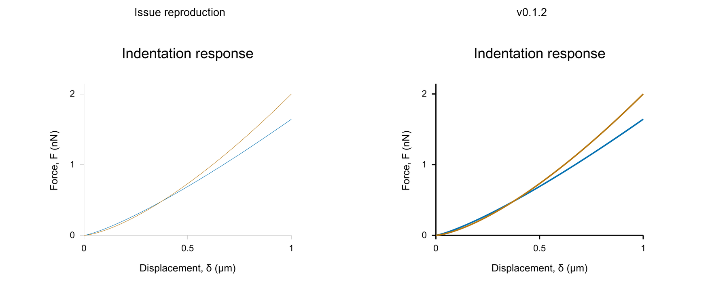

# v0.1.2：组合、版式与清晰度

所有图均为合成测试数据，由实际 PowerPoint 渲染。两组“问题复现”通过源代码显式设置标题偏移、额外说明和细灰线，用来检验新规则；它们不是旧版本普遍表现的统计结果。对照两侧使用相同数据。

## 1. 混合对象组合



包含 18 个文本框、23 个矢量形状和 1 张位图。交付文件包含整图组合和两个子图分组。完全拆分为 42 个独立对象后，PowerPoint 仍能重新组合；整体移动、缩小到 85%、修改文字和线宽、保存重开均通过。

[可编辑 PPTX](results/01_grouping.pptx) · [600 dpi PNG](results/01_grouping.png) · [600 dpi TIFF](results/01_grouping.tiff) · [编辑后 PPTX](results/01_grouping-edited.pptx)

## 2. 标题居中与简洁文字



右侧标题以绘图区左右边界为基准居中，省略显式标记的生成说明；坐标、单位和刻度保留。未标记的文字不会被自动删除。

[可编辑 PPTX](results/02_layout.pptx) · [600 dpi PNG](results/02_layout.png) · [600 dpi TIFF](results/02_layout.tiff) · [对照 PPTX](results/02_layout_before.pptx)

## 3. 黑色边框与清晰线条



左侧轴线为 #B8B8B8、0.35 pt，右侧为黑色、1.2 pt；曲线从 0.35 pt 改为 1.5 pt，数据坐标不变。两侧均以同一尺寸在 PowerPoint 中导出 600 dpi，因此对比展示的是颜色与线宽差异，而非人为模糊。

[可编辑 PPTX](results/03_clarity.pptx) · [600 dpi PNG](results/03_clarity.png) · [600 dpi TIFF](results/03_clarity.tiff) · [对照 PPTX](results/03_clarity_before.pptx)

## 验证记录

测试日期：2026-11-28。Windows PowerPoint 16.0，Office Build 16.0.20625.20108。三组新案例及两组受控对照均通过：

- 原生组合、取消组合、完全拆分后重新组合；
- 组合移动 12 pt / 8 pt、宽高缩小到 85%，保存后位置和尺寸保持；
- 子对象字号改为 18 pt、线宽改为 1.75 pt，保存重开后保持；
- 重新打开后仍能取消组合、重新组合。

三组新案例重新组合前后的渲染像素一致。PNG 分别为 5000 × 2250 或 2833 × 2250 像素，对应约 600 dpi（整数像素取整）。TIFF 使用无损 Deflate 压缩；经 Windows 解码器验证，与对应 PNG 像素一致。内嵌云图源图为 1230 × 900 像素，按放置尺寸为 432 ppi。网格和文字保留为矢量。

完整记录见 [report.json](results/report.json)。`*-edited.png` 展示刻意修改后的测试副本；`*-regrouped.png` 保留组合往返后的渲染。不同 Office 版本仍需复核。

## 复现

在仓库根目录运行；图例脚本需要 Pillow 和 Matplotlib（可使用 [gallery 依赖](../gallery/requirements.txt)），核心导出器仍只依赖 Python 标准库。以下输出目录必须尚不存在：

```sh
python examples/v012/build_cases.py --output build/v012-demo
python -m unittest discover -s tests -v
```

在装有 PowerPoint 的 Windows 桌面会话中运行：

```powershell
foreach ($case in @('01_grouping','02_layout','03_clarity','02_layout_before','03_clarity_before')) {
    ./tools/check_powerpoint.ps1 -InputPptx "build/v012-demo/$case.pptx" -OutputDirectory "build/v012-demo/$case-qa-final"
}
```

生成比较图及导出文件：

```sh
python examples/v012/publish_results.py build/v012-demo --output build/v012-public
```

`results/*.json` 是可直接输入场景导出器的源文件；分组示例还需同目录的 `field.png`。生成的图片不在图内添加验证说明。旧版四组 SVG 转形状案例见[原始对比](../gallery/README.md)。
